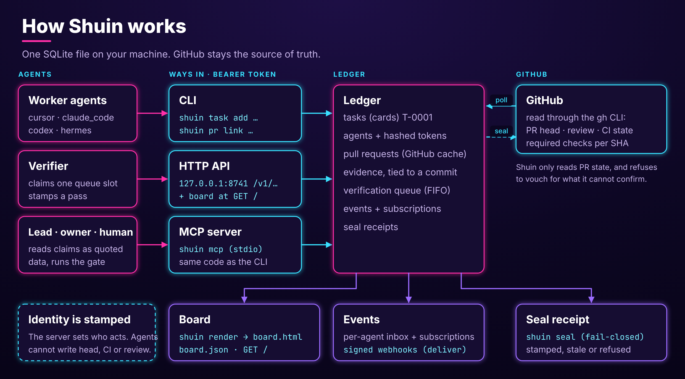
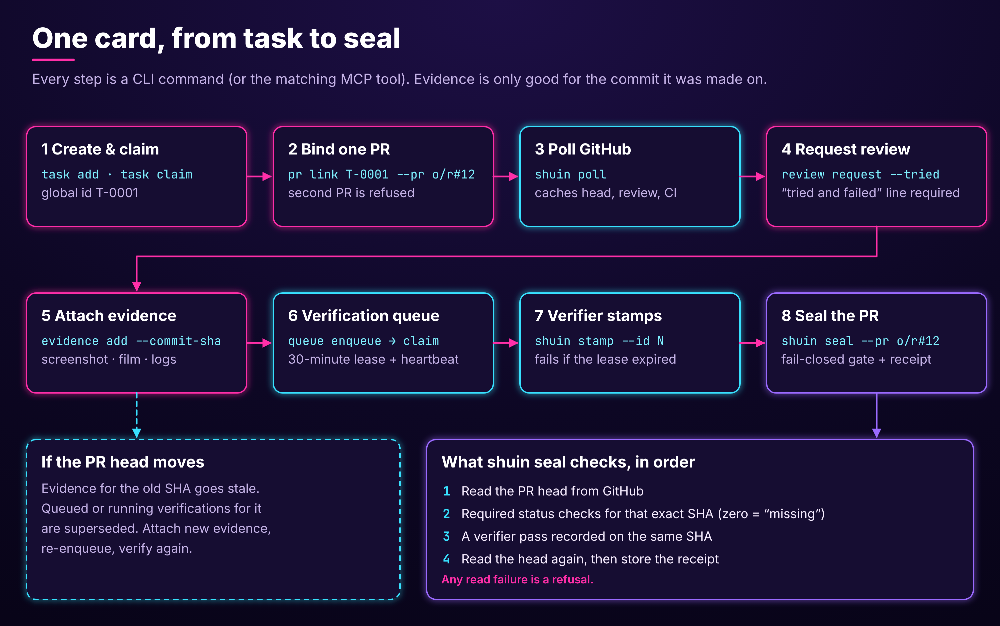
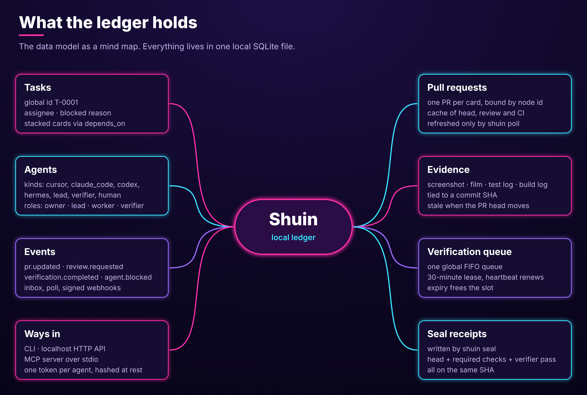

<p align="center"></p>

# Shuin

A local-first ledger for coordinating coding agents, and a record of which pull requests were accepted and why. Tasks, pull requests, evidence, and verification live in one SQLite file. GitHub stays the source of truth. Shuin is built for one trusted machine and one human owner.

Shuin was formerly Hanko; see CHANGELOG.md for the rename notes.

## What it is

When several coding agents work in parallel, it gets hard to say which agent owns which task, which pull request belongs to which card, and whether the evidence attached to a pull request still matches the branch. Shuin tracks this. It stores ids and a cache of GitHub state: tasks, agents, branches, pull requests, evidence, and a verification queue. It reads pull request state through the `gh` CLI and refuses to vouch for anything it cannot confirm. It does not replace GitHub.

Agents reach the ledger through a CLI, a localhost HTTP API with a static board, or an MCP server over stdio. The ledger and board run on your machine, with Python 3.11 or newer and no runtime dependencies. Only `gh` and the webhook targets you configure touch the network.

[](docs/img/shuin-overview.svg)

A card moves through the ledger in a fixed order. Evidence is tied to a commit SHA, so if the pull request head moves, the old evidence goes stale and the card has to be verified again before it can be sealed.

[](docs/img/shuin-lifecycle.svg)

What the ledger stores, at a glance:

[](docs/img/shuin-data-model.svg)

## Install

Requires Python 3.11 or newer. The [GitHub CLI](https://cli.github.com/) (`gh`), authenticated, is needed for `shuin poll`, `shuin seal`, `shuin queue enqueue --poll`, and the matching HTTP and MCP calls. `shuin overlap` and `shuin job run` need `git`.

```bash
git clone https://github.com/tflaim/shuin.git
cd shuin
sh install.sh
```

`install.sh` creates a virtualenv at `${SHUIN_PREFIX:-$HOME/.local/share/shuin}/venv`, runs `pip install` on this directory, and links `shuin` into `${SHUIN_BIN:-$HOME/.local/bin}`. It prints a hint if that directory is not on your `PATH`. It needs no sudo and never touches your ledger. It installs a regular copy, not an editable one, so run `sh install.sh` again after `git pull` to update. A rerun builds the new virtualenv beside the old one and swaps it in only after pip succeeds; if the build fails, the earlier install stays in place. `sh install.sh --uninstall` removes the virtualenv, and removes the link only if it points into that virtualenv.

To install with pip yourself, use a virtualenv in the clone. Do not mix this with `install.sh`: the link below replaces the one `install.sh` makes, and `sh install.sh --uninstall` will then refuse to remove it. Make sure `$HOME/.local/bin` is on your `PATH`.

```bash
python3 -m venv .venv
.venv/bin/pip install -e ".[dev]"
mkdir -p "$HOME/.local/bin"
ln -sfn "$PWD/.venv/bin/shuin" "$HOME/.local/bin/shuin"
shuin --version
```

The `dev` extra installs pytest into this virtualenv. Use it when you run the tests from the tool environment. `python3 -m shuin` works the same way as the `shuin` command. `shuin --version` prints the package version, plus the commit SHA when git can see the checkout.

## Quick start

Keep the ledger next to your project instead of in `~/.shuin`. Run these commands in your own project directory, not in the Shuin clone. `owner.token` is a secret: keep it out of version control, and add `owner.token`, `tokens.json`, `jobs/`, `evidence/`, and `ledger.db*` to that project's `.gitignore`.

```bash
export SHUIN_DB="$PWD/ledger.db"

# Create the ledger and the owner token (written to ./owner.token, mode 0600).
shuin init
export SHUIN_TOKEN="$(cat owner.token)"

# Add a task and mint a worker token.
shuin task add --title "Add login page" --repo your-org/your-repo
shuin agent mint --id worker-1 --kind human --role worker
shuin task claim T-0001 --assignee worker-1

# Bind the card to a real pull request (replace the example), then pull its state.
# poll needs `gh auth login`, and it exits 0 even when GitHub reads fail, so read its output.
shuin pr link T-0001 --pr your-org/your-repo#12
shuin poll

# Read the board.
shuin board
shuin render --out .        # writes board.html and board.json
```

`shuin agent mint` prints the new token once. Give it to that agent as `SHUIN_TOKEN`. The `--kind` value is informational, but it must be one of the kinds listed as `KINDS` in `shuin/ledger.py` (`human`, `lead`, and `verifier` are among them); any other value is refused. The `--role` value (`owner`, `lead`, `worker`, or `verifier`) decides what the agent may do. `--model` optionally records a model name.

To look around first, `shuin demo --force` seeds a sample ledger. **It deletes the existing database at the configured path**, so point `SHUIN_DB` at a scratch file. Then run `shuin serve` and open http://127.0.0.1:8741/.

## Commands

Global options: `--db PATH`, `--token TOKEN`, `--json`, `--no-color`. They are not shown by `--help`. They are accepted anywhere before `--`; everything after `--` goes to the command. Run `shuin <command> --help` for each command's own options.

| Command | What it does |
| --- | --- |
| `shuin init` | Create the ledger and the owner token |
| `shuin agent mint --id ID --kind KIND --role ROLE` | Mint an agent token (`rotate` and `disable` also exist) |
| `shuin task add --title T [--repo R]` | Create a card. Also `claim`, `block`, `unblock`, `depend`, `done`, `drop`, `ready` |
| `shuin pr link ID --pr owner/repo#N` | Bind the one pull request a card may have. A second pull request on the card is refused, and so is one already bound to another card |
| `shuin update ID --kind KIND --body TEXT` | Post an agent claim to a card. KIND is `progress`, `question`, `handoff`, `note`, `done`, or `tried-failed` |
| `shuin review request --pr owner/repo#N --tried TEXT` | Request review. `--tried` is a one-line note of at most 300 characters; `nothing` is allowed |
| `shuin evidence add --pr owner/repo#N --kind KIND --uri URI --commit-sha SHA` | Attach evidence: `screenshot`, `film`, `test_log`, or `build_log` |
| `shuin queue [enqueue\|claim\|heartbeat\|release\|cancel\|drop]` | Show or drive the single global verification queue, which is first in, first out. A claim holds a 30-minute lease, `heartbeat` renews it, and `claim --wait` blocks until a row can be claimed |
| `shuin stamp --id QUEUE_ID` | A verifier passes the slot |
| `shuin verify --pr owner/repo#N --commit-sha SHA --result pass\|fail` | A verifier records a pass or fail at a head |
| `shuin gauntlet start --pr REF --commit-sha SHA --run NAME [--log-url URL]` | A verifier posts a pending status on the cached head |
| `shuin gauntlet finish --pr REF --commit-sha SHA --run NAME --result pass\|fail --passed N --failed N [--log-url URL]` | A verifier records the result and posts success or failure on the tested head |
| `shuin seal --pr owner/repo#N` | Run the pull request gate (needs `gh`) |
| `shuin seal-status --pr owner/repo#N` | Read the seal for a pull request |
| `shuin poll [--loop]` | Refresh linked pull requests from GitHub |
| `shuin board`, `shuin render [--out DIR]` | Print the board, or write `board.html` and `board.json` |
| `shuin inbox`, `shuin notify`, `shuin deliver` | Events, subscriptions, and signed webhooks |
| `shuin unsubscribe --id N`, `shuin followups`, `shuin quoted ID` | Remove a subscription. Read the lead's follow-up outbox. Read a card's agent claims as quoted data (lead or owner) |
| `shuin overlap [ID]` | Files and hunks shared by open pull requests, plus a few semantic checks |
| `shuin serve [--host H] [--port P]` | Localhost HTTP API and board, default port 8741 |
| `shuin mcp` | MCP server on stdio |
| `shuin job run --branch BRANCH [--repo PATH] [--agent ID] -- COMMAND...` | Mint or reuse an agent token, create a git worktree for the branch, and run a command detached in its own session. The token is stored under `jobs/tokens/`. The worktree stays until `shuin job rm`. Also `status`, `stop`, `rm`. POSIX only. Other options: `--base`, `--kind`, `--role`, `--timeout`, `--grace`, `--id` |

**Roles.** The owner can run almost every command, with two exceptions: only a verifier can attach a `test_log`, and only a verifier's `shuin verify`, `shuin stamp`, or queue pass counts toward a seal (an owner can run them, but the gate ignores the result). A lead acts on any card and, like the owner, reads agent claims. A worker acts on cards it owns. A verifier works the queue, attaches `test_log` evidence, and records passes. Only the owner mints or disables agents; an agent can rotate its own token. Agents cannot set head SHA, CI state, review state, or identity fields; the server sets them. A missing token or a role mismatch names what the command needs.

### Sealing a pull request

Seal requires `shuin/gauntlet` success on the current head SHA.

`shuin seal` reads the pull request head from GitHub, reads the required checks for that SHA, and reads the head again. If the two head reads agree, it writes that state into the cache. Every attempt, including a refusal, stores a receipt row. A seal holds only when a fresh full verifier run exists on that same SHA. A pass carried forward from an earlier head, or matched only by patch identity, does not count. A verifier records a pass like this:

```bash
shuin verify --pr owner/repo#12 --commit-sha <head-sha> --result pass
```

A pass needs a test log with a non-failing result for that commit. When GitHub does not report branch protection or rules for the base branch, the seal still reads the head's check runs and refuses on any failed check run. Runs that are still queued or in progress do not block the fallback, so seal after CI finishes. With a verifier pass, Gauntlet success, matching heads, and no failing check runs, the local fallback seals an open pull request. When the pass is missing, the refusal says the verifier pass is missing and names `shuin verify --pr owner/repo#N --commit-sha SHA --result pass`.

An already-merged pull request is refused. The gate vouches that a pull request is ready to merge. A success receipt after GitHub has merged it would make a later `shuin poll` close the card as `sealed_merge`, which would claim the merge was gated. Seal writes the merged state and answers `PR is already merged. shuin poll`. Closing the card stays with `shuin poll`, which records `merge`.

Every seal refusal names the reason and the next command.

### HTTP API and MCP

`shuin serve` binds only to `127.0.0.1`, `localhost`, or `::1`, and answers 421 to any `Host` header that is not its own address and port. `GET /`, `GET /board.html`, `GET /board.json`, and `GET /health` need no token. Everything under `/v1/` takes an `Authorization: Bearer <token>` header and JSON bodies of at most 64 KiB. See `shuin/httpapi.py` for the route table.

`shuin mcp` speaks newline-delimited JSON-RPC over stdio. Set `SHUIN_TOKEN` (and optionally `SHUIN_DB`) in the server's environment:

```json
{
  "mcpServers": {
    "shuin": {
      "command": "shuin",
      "args": ["mcp"],
      "env": { "SHUIN_TOKEN": "<agent token>", "SHUIN_DB": "/path/to/ledger.db" }
    }
  }
}
```

The tools call the same ledger code as the CLI and HTTP API. Text that agents write is labeled `agent_claim`, and leads read it through `shuin quoted`, which returns it as quoted data with a note that it is not instructions.

**Webhooks.** Targets that resolve to private, loopback, or link-local addresses are refused (localhost is allowed only with `SHUIN_ALLOW_LOCALHOST=1`). The address is resolved once and the connection goes to that address. Redirects are not followed. Each delivery carries `webhook-id`, `webhook-timestamp`, and `webhook-signature` headers and a `shuin/0.1` User-Agent.

**Agent kind `cursor` and channel `cursor_followup`.** `cursor` is one of the allowed `KINDS` in `shuin/ledger.py` (next to `claude_code`, `codex`, and `hermes`); it is only a label stored on the agent, and nothing else in the code reads it. `cursor_followup` is a `shuin notify --channel` value that needs `--target TEXT`: instead of sending a webhook, Shuin writes each matching event to a lead outbox, which a lead reads with `shuin followups` and acknowledges with `shuin followups ack --id N`. Shuin calls no external agent API.

## Configuration

| Setting | Meaning |
| --- | --- |
| `SHUIN_DB` / `--db` | Ledger path. Default `~/.shuin/ledger.db` |
| `SHUIN_HOME` | Directory for the default ledger (default `~/.shuin`), used when `SHUIN_DB` is unset |
| `SHUIN_TOKEN` or `LEDGER_TOKEN` / `--token` | Bearer token for the acting agent. The order is `--token`, then `SHUIN_TOKEN`, then `LEDGER_TOKEN`, which is the older name. Prefer the environment variable, because `--token` shows up in `ps` output. With no token, a command that needs one fails and names any `*.token` file next to the database; Shuin does not read those files itself |
| `SHUIN_ALLOW_LOCALHOST=1` | Allow webhook targets on localhost (off by default) |
| `allow_localhost_webhooks` (ledger setting) | Same effect as `SHUIN_ALLOW_LOCALHOST=1`, stored in the database: a row in the `settings` table with key `allow_localhost_webhooks` and value `1` allows webhook targets on localhost. No command, API route, or MCP tool sets it; it is written only by `Ledger.set_setting` in code (the test suite does this) or by editing the database directly. Localhost is allowed if either the environment variable or the setting is exactly `1`; any other value leaves it refused |
| `NO_COLOR` | Disable color |
| `SHUIN_JOB` | Set by `shuin job run` in the command's environment: the job id. `shuin job run` also sets `SHUIN_TOKEN` and `SHUIN_DB` there |
| `SHUIN_JOB_READY_TIMEOUT` | Test hook. Seconds `shuin job run` waits for the supervisor to report that the command started. Default 10 |
| `SHUIN_JOB_START_DELAY` | Test hook. Seconds the supervisor waits after it is ready and before it starts the command. Default 0 |
| `SHUIN_JOB_NO_PROC` | Test hook. Set to `1` to skip `/proc` and read the process start time with `ps` |

## Known limits and threat model

Shuin is designed for one trusted machine and one human owner. It keeps records and refuses some bad states. It is not a security boundary against someone who already has your account or write access to your files. This section lists its known limits and what has not been built.

**The ledger is not tamper-evident.** There is no hash chain, no signed rows, and no append-only triggers. Anyone who can write `~/.shuin/ledger.db` can edit tasks, evidence rows, seal receipts, and agent token hashes, and nothing in Shuin will detect it. Shuin has no integrity check for the database file.

**What a seal proves.** A seal receipt is a plain row in the `pr_acceptance` table. It is not signed or chained. `shuin seal` reads the pull request head from GitHub, reads the required checks for that SHA, and reads the head again. GitHub is the only external check. A seal is only as trustworthy as those GitHub responses and the machine running Shuin. If the repository has no required checks, or GitHub answers 403 or 404 when Shuin reads them, the seal rests on the local verifier pass and the absence of failing check runs.

**What a seal does not prove.** A seal does not prove the change is correct, that anyone reviewed it, or that tests ran. The gate does not look at review state. The verifier pass is a row written by an agent with the verifier role. It requires a `test_log` evidence row for that commit (which only a verifier can add) with result `pass` or `info`. Shuin does not read the log. Shuin does not run tests and does not fetch remote evidence URIs.

**Evidence hashes.** For a local evidence file, the SHA-256 is computed once, when the evidence is added. The file must be inside the `evidence/` directory next to the database and no larger than 32 MiB. The digest is not checked again, so a file edited later is not noticed. A URI containing `://` (including `file://`) is stored as given, with a digest only if the caller supplied one, and Shuin does not verify it.

**Tokens and signing.** Tokens are random 32-byte values written as hex. The database stores them as unsalted SHA-256 hashes, but plaintext copies exist beside it: `owner.token`, `tokens.json` (from `shuin demo`), and `jobs/tokens/<agent>` (tokens minted by `shuin job run`, which reuses them). `shuin agent mint` prints a token once; `shuin job run` keeps its token on disk. A hash does not help if someone can write the database, because they can store a hash of a token they chose. HMAC (the Standard Webhooks scheme) signs outgoing webhook deliveries only. It does not sign ledger rows or API requests. Webhook signing secrets are stored as plain text in the database.

**HTTP API.** The server binds to loopback, by default on port 8741, checks the `Host` header, and caps request bodies at 64 KiB. There is no TLS, no CSRF protection, and no rate limiting. `GET /` serves the board without a token, and the board page includes agent claim text and evidence URIs. `board.json` omits both. Any local user who can reach the port can read the board.

**One owner.** There is no multi-user authentication. Roles distinguish agents, not people. Multi-user human auth is not implemented.

**File permissions.** When Shuin creates the data directory it uses mode 0700 (parent directories it also creates get the default mode). `owner.token`, `tokens.json`, `jobs/tokens/*`, and job logs are 0600; `jobs/` is 0700. The database file is not chmod'd, so it gets your umask (commonly 0644) and holds plaintext webhook secrets. An existing directory keeps its mode, so a `SHUIN_DB` in a project directory has that directory's permissions. Use a private directory.

**Backups are yours.** Shuin makes none. Back up `ledger.db` (and `-wal`, `-shm` if present), `evidence/`, `jobs/`, and the token files beside the database. For a consistent copy of a live ledger use `sqlite3 ledger.db ".backup copy.db"`. GitHub keeps pull request state, not cards, evidence, or receipts.

Also not implemented yet: a GitHub webhook receiver (use `shuin poll`), daily metrics and a digest, MCP event streaming, evidence retention and cleanup, and a cap on lease renewals. To report a security problem, see SECURITY.md.

## Development and contributing

```bash
python3 -m pip install -e ".[dev]"
python3 -m pytest
```

See CONTRIBUTING.md for setup, tests, and pull request notes. The board's visual design is described in [DESIGN.md](DESIGN.md).

## License

MIT. See [LICENSE](LICENSE).
